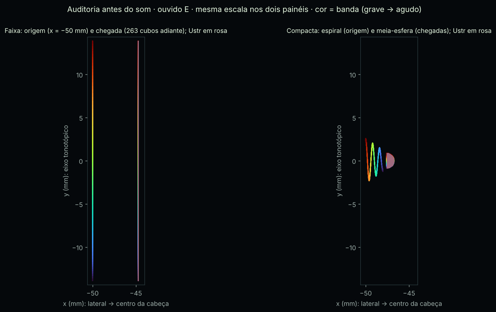
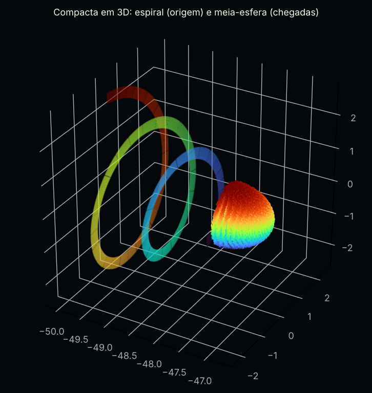

# V0.19 — Auditoria geométrica da entrada auditiva compacta, antes do som

**De Claudia, para revisão de Paulo e Clara · 28/11/2026.** Responde a `proposta-coordenadas-auditivas.md`. Aqui só há geometria: oportunidades de encontro, não coincidências. Nenhum som foi apresentado e nenhum piloto foi rodado.
**Código:** `motor/coordenadas.py` (coordenadas) e `motor/auditoria_coordenadas.py` (auditoria). Dados completos, com as matrizes 64 × 64, em `visual/auditoria/auditoria.json`. Figuras em `visual/auditoria/`.
**Marcas:** [R] responsável · [C] Clara · [E] escolha de engenharia da Claudia, a revisar · [M] medido.

## 1. Parametrização em cubos (ouvido E; o D é o espelho em x, com os mesmos identificadores de banda)

| Item | Valor | Marca |
|---|---|---|
| Espiral da Utrd (origem) | 2,5 voltas; raio da base ~121 cubos, raio do ápice ~55 cubos (escalados para caber os 1.388 cubos da faixa); altura de 100 cubos, rumo ao centro da cabeça; base = extremo agudo, ápice = graves; a largura da faixa (16 colunas de sensibilidade) fica na direção radial | [E]. A base aguda vem da cóclea. As 2,5 voltas são de memória, a conferir |
| Meia-esfera (chegada) | raio de **44 cubos** (0,88 mm). Face plana em x = −2.380, 120 cubos para dentro do plano da base da espiral. A cúpula aponta para o centro da cabeça | [E] |
| Eixo normal (n) | perpendicular à face plana, para dentro | [C] |
| Eixo tonotópico (t) | tangente à face plana (y), atravessa o volume de ponta a ponta. Graves num extremo, agudos no outro, intermediárias no meio do volume | [C] |
| "Meio da faixa" | centro da sequência das 64 bandas (ordem da V0.18), não uma frequência em Hz | [C, E] |
| Cortes de frequência | **pela capacidade**: cada banda recebe um trecho de t com volume proporcional ao seu número de pontos. Espessuras de 1,03 a 5,35 cubos (finas no meio, grossas nas pontas) | [E] |
| Dentro de cada corte (meio disco) | posição fina na banda → ângulo; sensibilidade → raio (uniforme em área); a espessura do corte é percorrida em sequência quase uniforme. Cada ponto ocupa o cubo livre do corte mais próximo do seu alvo. Um ponto de chegada por Upro | [E] |
| Densidade de chegada | 178.409 cubos de volume para 21.731 pontos: ~8,2 cubos por ponto | [E] |
| Ustr | grade regular de 3 × 4 × 3 cubos (t, n, v) dentro do volume: **4.958 Ustr**, ~4,4 Upros por Ustr. Territórios exclusivos (centro mais próximo; empate = menor índice), sem comunicação entre Ustr | [R] para a densidade (~1 por 4) e para a exclusividade; [E] para a grade |
| Percurso | **comprimento comum de 263 cubos** para todas as Upros de entrada: atraso de 17,53 ms para todas (dispersão zero) e 3.156 reacessos para completar o crescimento | [R] para ~1/3 de 790; [E] para "comum" |
| O percurso cabe? | distância entre as pontas de cada Upro: 20,5 a 204,1 cubos (mediana 135,4). **Todas abaixo de 263** | [M] |

**Se o percurso fosse a distância entre as pontas** (alternativa), os atrasos iriam de 1,37 a 13,56 ms, uma dispersão de ~12 ms. É muito maior que a janela de coincidência de 0,3 ms, e mudaria por si só quem pode coincidir. Por isso a proposta é o comprimento comum.

## 2. Vistas em escala comum

Os destinos são **potenciais**: nenhuma Upro cresceu ainda.

## 3. Oportunidades de encontro: faixa × compacta [M]

A faixa é a mesma a 790 e a 263 cubos. A matriz é idêntica nas duas; só mudam o atraso e o tempo de crescimento.

| | Faixa | Compacta |
|---|---|---|
| Territórios com Upro | 5.552 (todos) | 4.843 de 4.958 (115 vazios, nas bordas) |
| Upros por território (mediana · máximo) | 4 · 4 | 4 · 14 |
| Pares possíveis | 31.988 | 45.468 |
| — da mesma banda | 31.318 (**98%**) | 11.704 (26%) |
| — de bandas vizinhas | 670 (2%) | 24.782 (55%) |
| — de bandas a 2 ou mais de distância | **0** | 8.982 (20%) |
| Maior afastamento entre bandas num mesmo território | 1 | 4 |
| Bandas sem parceiro | 0 | 0 |
| Parceiros por Upro (mediana) | 3 | 4 |
| Distância ao vizinho mais próximo (mediana) | 1 cubo | 1 cubo |
| Bandas distintas a até 3 cubos (média) | 0,23 | 3,88 |

**Leitura [E], para discutir:**
1. Na faixa, quase todas as oportunidades são **dentro da mesma banda**. A matriz é uma diagonal fina.
2. Na compacta, a matriz vira uma **faixa larga**: cada banda pode encontrar até ~4 bandas de distância. Nenhum extremo virou vizinho do outro: o grave mais distante que encontra o agudo continua longe, e o afastamento máximo é 4.
3. **O centro tem mais direções, mas não mais proximidade.** A distância ao vizinho mais próximo é a mesma no meio e nas pontas (~1 cubo). Mas, a até 3 cubos, as bandas do meio (20–43) veem em média 4,2 bandas distintas, e as das pontas (0–3 e 60–63) veem 2,0. Como a Clara previu, as duas coisas foram medidas separadamente.

### Por banda (amostra; a tabela completa está no JSON)

| Banda | Pontos | Ustr acessíveis (faixa · compacta) | Parceiros por Upro (faixa · compacta) | Bandas parceiras (faixa · compacta) | Bandas a até 3 cubos (compacta) |
|---|---|---|---|---|---|
| 0 (ponta grave) | 231 | 63 · 62 | 2,97 · **5,75** | 2 · 2 | 0,44 |
| 1 | 224 | 64 · 105 | 2,92 · 4,29 | 3 · 4 | 2,0 |
| 15 | 376 | 96 · 237 | 2,94 · 4,20 | 1 · 6 | 3,89 |
| 31 (meio) | 427 | 112 · 238 | 2,95 · 4,13 | 2 · 6 | 4,61 |
| 32 (meio) | 426 | 112 · 328 | 2,99 · 4,49 | 2 · 7 | 4,61 |
| 48 | 325 | 85 · 259 | 2,98 · 4,07 | 2 · 9 | 4,38 |
| 62 | 216 | 64 · 120 | 2,82 · 3,31 | 3 · 4 | 2,03 |
| 63 (ponta aguda) | 208 | 56 · 73 | 2,92 · **4,97** | 2 · 3 | 0,57 |

**Achado: concentração nas bordas [M].** 110 territórios (2%) têm 9 ou mais Upros, quase todos na **ponta grave (banda 0)**, junto à face plana. A grade de Ustr não chega até a superfície curva nem até a face plana: as células da borda ficam maiores e recolhem mais pontos. Por isso a banda 0 tem 5,75 parceiros por Upro, mas só 2 bandas parceiras. **Antes de um piloto, convém corrigir a regra de borda.** Por exemplo, uma grade deslocada para encostar na face plana, ou Ustr extras na casca. A escolha é para decidir.

## 4. Braços propostos para o contraste (para decisão de Paulo)

| Braço | Entrada | Percurso | Regra das Uints |
|---|---|---|---|
| Controle histórico | faixa | 790 cubos | **B** (na superfície de entrada ou para dentro), o "B" do teste de 90 s |
| Encurtamento | faixa | 263 cubos | B |
| Reorganização | meia-esfera | 263 cubos (comum) | B (na face plana ou para dentro) |

Estímulo, estado inicial, plasticidade (ganho de 0,0065; punição de 1/60) e regra territorial ficam iguais nos três braços.

Com o percurso comum, o atraso entre as Upros não muda de um braço para outro. Mas o encurtamento muda **quando** as Upros ficam prontas (3.156 reacessos em vez de 9.480). Faixa a 263 contra meia-esfera a 263 isola a reorganização da entrada. Faixa a 790 contra faixa a 263 isola o encurtamento.

## 5. O que falta decidir antes de um piloto

1. Os números da seção 1, principalmente o raio de 44, a grade de Ustr e o percurso comum.
2. A regra de borda das Ustr (o achado de concentração).
3. Os braços e a regra das Uints comum (B).
4. **Engenharia que vem depois** da autorização: o motor ainda usa territórios por bloco (y, z) da faixa. Para a meia-esfera, preciso trocar para territórios 3D (centro mais próximo) e para a mesma caixa de busca da Uint, com o filtro "na face ou para dentro".
