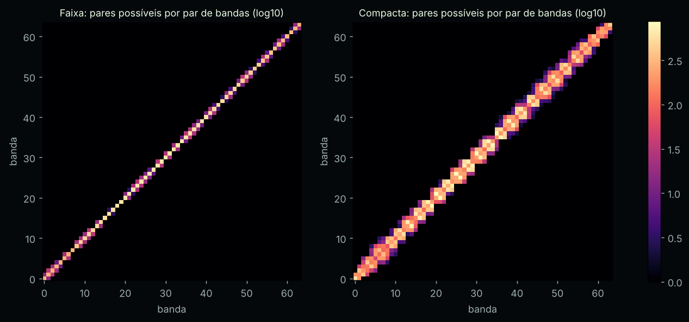
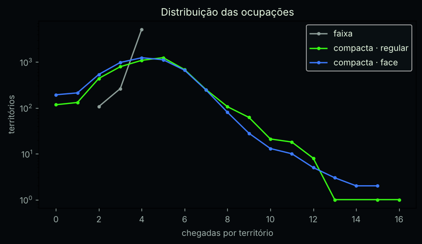

# V0.19 — Auditoria geométrica da entrada auditiva compacta, antes do som (revisão 1 + decisão da grade)

**De Claudia, para revisão de Paulo e Clara · 28/11/2026.** Responde a `proposta-coordenadas-auditivas.md` e às correções pedidas por Paulo (28/11, 14:37).
**O que é:** só geometria, ou seja, oportunidades de encontro, não coincidências. Nenhum som foi apresentado, nenhum piloto rodou e o motor não foi alterado.
**Código:** `motor/coordenadas.py` e `motor/auditoria_coordenadas.py`. Dados completos, com as matrizes 64 × 64, a lista dos territórios sobrecarregados e as tabelas por banda, em `visual/auditoria/auditoria.json`.
**Marcas:** [R] responsável · [C] Clara · [E] escolha de engenharia da Claudia · [M] medido.

## 0. Decisões de Paulo nesta etapa [R]

- Meia-esfera de raio **44 cubos** e percurso comum de **263 cubos**, como parâmetros provisórios.
- Autorizado: revisar as coordenadas e repetir a auditoria sem som.
- **Não autorizados ainda:** alterar o motor e rodar o piloto de 10 s.
- Os três braços ficam no desenho, todos com a regra B das Uints.

## Decisão de Paulo (28/11, 14:52): grade 3 × 3 × 3, com mitigação [R]

"Perfeito. Siga com 333 e a mitigação proposta."

- **Grade adotada:** **3 × 3 × 3**, em coordenadas inteiras.
  - Primeira camada em n = 1, de modo que cada camada cobre três planos (n = 0, 1, 2 na primeira).
  - Resultado: **6.739 Ustr**, ~3,22 Upros por Ustr.
  - Isso **revisa a regra de densidade** de ~1 Ustr por 4 pontos (23/11) para ~1 por 3,2, na entrada compacta.
- **Efeitos medidos [M]** (comparação completa na seção 2b):
  - territórios com 9 ou mais chegadas: 112 → **49** (o acaso daria ~40);
  - junto à face: 51 → **1**;
  - pares concentrados nos sobrecarregados: 11,1% → **6,5%**;
  - empates exatos: 4.767 → 243 (não zero: sobram os empates em diagonal);
  - pares possíveis: 45.198 → **33.794** (−25%), com a mesma proporção por afastamento;
  - bandas comparáveis no território: 1,80 → 1,63;
  - bandas a até 3 cubos: 3,89 (igual).
- **Mitigação [R]:**
  - a diferença de densidade entre os braços (faixa: 4 Upros por Ustr; compacta: ~3,2) fica **declarada como parte do efeito conjunto** no contraste faixa 263 × compacta 263;
  - **se a Clara achar necessário**, um braço de controle posterior, com a faixa em territórios de mesma densidade (~3,2 por Ustr), separa o efeito do tamanho do território do efeito da organização das chegadas. Não entra agora.

### 2b. Grade adotada × anteriores (ouvido E) [M]

| | 3 × 3 × 3 (adotada) | 3 × 4 × 3 regular | 3 × 4 × 3 com camada na face |
|---|---|---|---|
| Ustr · Upros por Ustr | 6.739 · 3,22 | 4.955 · 4,39 | 5.324 · 4,08 |
| Territórios vazios | 396 | 117 | 193 |
| Ocupação máxima | 12 | 16 | 15 |
| Com 9 ou mais chegadas (acaso daria) | 49 (~40) | 112 (~174) | 63 (~127) |
| — junto à face · junto à curva | 1 · 4 | 51 · 16 | 1 · 9 |
| Fração dos pares nos sobrecarregados | 6,5% | 11,1% | 7,3% |
| Pares possíveis por afastamento 0 · 1 · 2 · 3 · 4 | 7.711 · 19.322 · 6.469 · 289 · 3 | 11.636 · 24.864 · 8.284 · 409 · 5 | 10.682 · 23.531 · 7.883 · 385 · 1 |
| Bandas comparáveis no território · a até 3 cubos | 1,63 · 3,89 | 1,80 · 3,89 | 1,77 · 3,89 |

## 1. Correções feitas

1. **Grade de Ustr em coordenadas inteiras**, sem arredondamento.
   - Passos de 3 × 4 × 3 (t, n, v). Em t e v, os centros caem em …, −3, 0, 3, …, simétricos em torno do meio.
   - Na versão anterior, `np.round` de meios cubos gerava intervalos alternados de 2 e 4 cubos, como Paulo apontou.
2. **Desempate entre todas as Ustr empatadas.** Quando há empate na distância, vale o menor índice entre todas as empatadas. Antes, só duas eram consideradas.
   - Efeito colateral a declarar: o passo 4 em n é par. Por isso, os planos n = 4, 8, 12… ficam a igual distância de duas camadas, e o desempate por índice os entrega sempre à camada de **menor n** (mais perto da face).
3. **Correção de uma afirmação minha errada.** Eu tinha escrito que quase todos os territórios sobrecarregados ficavam na ponta grave. Generalizei a partir dos seis primeiros da lista, e Paulo tinha razão em desconfiar. Na grade corrigida, **só 8 dos 112** recebem a banda 0 (seção 3).

## 2. Configurações avaliadas [M]

| | Faixa (790 e 263) | Compacta · grade regular | Compacta · grade com camada na face |
|---|---|---|---|
| Primeira camada de centros | — | n = 2 (meio passo da face) | n = 0 (na face) |
| Ustr | 5.552 | **4.955** (~4,39 Upros por Ustr) | 5.324 (~4,08) |
| Territórios vazios | 0 | 117 | 193 |
| Ocupação (mediana · máximo) | 4 · 4 | 4 · 16 | 4 · 15 |
| Territórios com 9 ou mais chegadas | 0 | **112** | 63 |
| Pares possíveis | 31.988 | 45.198 | 42.482 |
| — mesma banda (afastamento 0) | 31.318 (98%) | 11.636 (26%) | 10.682 (25%) |
| — afastamento 1 | 670 (2%) | 24.864 (55%) | 23.531 (55%) |
| — afastamento 2 | 0 | 8.284 (18%) | 7.883 (19%) |
| — afastamento 3 | 0 | 409 | 385 |
| — afastamento 4 | 0 | 5 | 1 |
| Afastamento máximo | 1 | 4 | 4 |
| **Bandas comparáveis no território da mesma Ustr** (média por chegada) | 0,04 | **1,80** | 1,77 |
| **Bandas a até 3 cubos** (média por chegada) | 0,23 | **3,89** | 3,89 |

As duas medidas em negrito respondem a perguntas diferentes, e ficam separadas como pedido:
- **bandas comparáveis no território:** com quem a Ustr pode de fato comparar uma incidência que não integrou;
- **bandas a até 3 cubos:** quem está perto no espaço, comparável ou não.

A diferença entre elas (1,8 × 3,9) mostra que **metade da vizinhança espacial cai em territórios vizinhos**. Ela fica próxima, mas não é comparável.

## 3. Onde está a sobrecarga [M]

Cruzei cada território com 9 ou mais chegadas com as bandas que ele recebe e com a distância do seu centro à face plana e à superfície curva.

| | Grade regular | Grade com camada na face |
|---|---|---|
| Territórios sobrecarregados | 112 | 63 |
| — com centro a até 2 cubos da face plana | **51** | 1 |
| — a até 2 cubos da superfície curva (fora da face) | 8 | 9 |
| — no interior | 53 | 53 |
| — que recebem a banda 0 | 8 (todos só com a banda 0) | 4 |
| — que recebem a banda 63 | 5 | 3 |
| **Fração dos pares possíveis concentrada neles** | **11,1%** (4.998 pares) | 7,3% (3.099) |
| Esperado se as chegadas caíssem ao acaso (Poisson, mesma média) | ~174 | ~127 |
| Ocupação média das camadas mais próximas da face | 4,74 (n = 2) e 4,81 (n = 6), contra 4,39 no geral | **2,86** (n = 0), contra 4,08 no geral |

**Leitura [E]:**
1. **A maior parte da sobrecarga não é efeito de borda.** Os 53 territórios do interior aparecem nas duas grades. E o total observado fica **abaixo** do que daria uma distribuição ao acaso. As chegadas seguem a ordem das bandas, não a grade das Ustr, então a ocupação flutua de 0 a 16 em torno de 4. É a cauda natural, não um defeito localizado.
2. **Há uma parte sistemática junto à face na grade regular**: 51 dos 112, e as duas primeiras camadas ~8–10% acima da média. Duas causas:
   - o desempate entrega os planos empatados (n = 4, 8, …) à camada mais próxima da face;
   - o plano n = 0 conta como um plano inteiro de cubos.
3. **A camada na face** elimina a sobrecarga junto à face (1 em vez de 51) e baixa a concentração de pares de 11,1% para 7,3%. Em troca, as células da face ficam pela metade (2,86 chegadas em média), sobram 193 territórios vazios e o número de Ustr muda (5.324).
4. **Junto à superfície curva** persistem só 8–9 territórios. Pelo critério de Paulo, isso **não justifica** Ustr extras na casca.

## 4. Recomendação de borda [E]

1. **Não acrescentar Ustr na casca curva.** A concentração junto a ela é pequena (8–9 territórios).
2. **Manter a grade regular (primeira camada em n = 2)** e declarar duas coisas:
   - a cauda de ocupação, que é flutuação esperada e menor que ao acaso;
   - o viés do desempate junto à face, que concentra ~11% dos pares possíveis em 2% dos territórios, com metade deles junto à face.

   A camada na face troca uma assimetria por outra (células da face pela metade e mais territórios vazios). Por isso não vejo ganho claro em adotá-la.
3. **Opção, se vocês preferirem eliminar o viés sistemático:** um passo ímpar em n (3 × 3 × 3). **Correção:** escrevi que ele tirava todos os empates exatos, mas ele tira os empates de plano e sobram 243 em diagonal. Muda a contagem para 6.739 Ustr (~1 por 3,2). **Adotada por Paulo; ver a decisão acima.**

## 5. Percurso: comprimento de condução, não trajetória [M]

- **O que o motor faz hoje:** a Upro de entrada **não percorre cubos**. Ela cresce contando reacessos (12 por cubo) e, depois de pronta, a incidência chega com atraso de comprimento × 66,7 µs. Os 263 cubos são, portanto, **comprimento de condução**: 17,53 ms de atraso e 3.156 reacessos.
- **Se for exigida uma trajetória discreta:** a regra de deslocamento do motor (a mesma dos ramos) avança 1 cubo por passo entre os 26 vizinhos, ou seja, a distância de Chebyshev. A maior distância mínima entre as pontas é de **158 passos**, abaixo de 263. Toda Upro é realizável, com até 105 passos de desvio.
- **Distância euclidiana entre as pontas:** de 20,4 a 204,1 cubos (mediana 136,0).
- **Atualização de 28/11 (tarde) [R]:** a espiral virou, com a base (agudos) voltada para o núcleo, e a face da meia-esfera passou para 50 cubos além da base da espiral (antes 120 cubos a partir do lado de fora). Com isso:
  - a maior distância de Chebyshev passou a **172 passos** (realizável em 263);
  - a distância euclidiana passou a **87,4–195,1 cubos** (mediana 150,5);
  - territórios, ocupação e pares não mudam, porque a meia-esfera só se deslocou ao longo do eixo;
  - o motor também não muda: o braço compacta 263, rodado de novo, deu as mesmas Uints, pares e disparos, só transladadas 30 cubos (ver `teste-60s-tres-bracos.md`).

## 6. Braços (mantidos) e o que eles avaliam

| Braço | Entrada | Percurso | Regra das Uints | Avalia |
|---|---|---|---|---|
| Controle histórico | faixa | 790 | B | — |
| Encurtamento | faixa | 263 | B | 790 × 263: o encurtamento, inclusive o momento em que as Upros completam o crescimento (9.480 → 3.156 reacessos) |
| Reorganização | meia-esfera | 263 (comum) | B (na face plana ou para dentro) | faixa 263 × compacta 263: a reorganização **conjunta** das chegadas e dos territórios das Ustr |

O contraste A × B (folha fixa × profundidade local) continua documentado em `preregistro-folha-x-profundidade.md`, como a pergunta sobre permitir profundidade às Uints.

## 7. Previsto para o futuro piloto (registro por afastamento entre bandas)

Para cada afastamento (0, 1, 2, …), o piloto registraria três contagens:
1. **pares disponíveis:** a geometria desta auditoria;
2. **pares com as duas Upros prontas**, no instante de cada apresentação. O motor já registra quando cada Upro do nervo completa o crescimento;
3. **pares que efetivamente coincidiram**, pela primeira coincidência de cada par. O motor já guarda os dois membros e o instante (`p_t`).

As três contagens saem por afastamento, como na tabela da seção 2. A implementação fica para depois da autorização.

## 8. Para decidir

1. A recomendação de borda da seção 4: grade regular, sem casca, viés declarado; ou a opção do passo ímpar.
2. Se a configuração está pronta para entrar no motor. A engenharia seguinte, ainda não feita, é trocar os territórios por bloco (y, z) por territórios 3D (centro mais próximo), aplicar a regra B na meia-esfera e acrescentar o registro da seção 7.
